Kandi

<p align="center">
  
</p>

<p align="center">
  
  
  
  
</p>

<p align="center">
  A lead-capture app that routes every customer lead to the dealer who covers its pincode,<br />
  plus a script that cleans the old <code>legacy_leads.csv</code> export and imports it into the same database.
</p>

<p align="center">
  <a href="#-what-it-does">What it does</a> ·
  <a href="#-how-to-run-it">Run it</a> ·
  <a href="#-how-dealer-assignment-works">Dealer assignment</a> ·
  <a href="#-data-problems-found-in-legacy_leadscsv">Data problems</a> ·
  <a href="#-assumptions">Assumptions</a>
</p>

---

Practical assignment for the **MIS Assistant** role at PURE Energy.

## ⚡ What it does

| Part | What was built |
|---|---|
| 🟢 **A. Lead app** | A form that validates name, mobile, pincode, product and source, keeps a mobile number that is already saved as a repeat enquiry (flagged, not blocked), assigns the dealer by pincode, and saves the lead to Firestore. A dashboard shows live counts by status and dealer, marks repeat enquiries, and has filters and an inline status editor. |
| 🔵 **B. Data cleanup** | `scripts/clean-and-import.js` reads all 40 legacy rows, fixes what can be fixed safely, rejects what can't, and writes `reports/reconciliation.csv` with one line per decision. It then imports the dealers and cleaned leads into Firestore. |
| 🟣 **C. AI log** | `AI_LOG.md` records which AI tools were used, the three most useful prompts, and a time the AI was wrong. |
| 🟠 **D. Next steps** | `NOTE.md` describes what I would build next for PURE Energy's dealers. |

**Built with:** HTML, CSS and JavaScript (no build step), Firebase Firestore, Firebase Hosting, and Node.js for the import script.

## 🗂️ Project layout

```
public/                  The web app (this folder is what gets deployed)
  index.html             "New Lead" form
  dashboard.html         Dashboard: counts by dealer and status, editable status
  firebase-init.js       Firebase project config
  app.js                 Form validation and save-to-Firestore logic
  dashboard.js           Live lead list and status updates
  dealer-assign.js       The pincode -> dealer matching rule
  validate.js            Phone, pincode and name checks
  style.css

scripts/
  clean-and-import.js    Cleans data/legacy_leads.csv and imports it

data/
  dealers.csv            Source data (unchanged)
  legacy_leads.csv       Source data (unchanged)

reports/
  reconciliation.csv     Output of the cleaning script: lead_id, action, reason

firestore.rules          Firestore Security Rules
firebase.json            Firebase Hosting config
banner.svg               README banner
AI_LOG.md                Part C
NOTE.md                  Part D
submission.json
```

## 🚀 How to run it

1. **Install Node.js** (v18 or newer), then in the project folder:
   ```
   npm install
   ```

2. **Create a Firebase project** (free plan, no credit card):
   - Go to https://console.firebase.google.com and choose Add project.
   - Build -> Firestore Database -> Create database (a region close to India
     is fine; start in production mode, the rules in `firestore.rules`
     control access).
   - Click the `</>` (web) icon to register a web app. It shows a
     `firebaseConfig` object.
   - Paste those values into `public/firebase-init.js`, replacing the
     `REPLACE_WITH_...` placeholders.

3. **Publish the security rules.** Copy `firestore.rules` into Firestore
   Database -> Rules -> Publish (or deploy them in step 6).

4. **Get a service account key** (only the import script needs this, the
   website does not):
   - Firebase console -> Project settings -> Service accounts ->
     Generate new private key.
   - Save the file as `service-account-key.json` in the project root. It is
     listed in `.gitignore`, so it is never committed.

   > [!IMPORTANT]
   > Treat this key like a password. Never commit it or share it, and delete
   > it from the Google Cloud console once the import is done.

5. **Clean and import the legacy data:**
   ```
   npm run clean-and-import
   ```
   This writes `reports/reconciliation.csv`. If the service account key is
   present it also uploads the `dealers` and `leads` collections. Without the
   key, or with `--dry-run`, it only cleans the data and writes the report
   and nothing is uploaded. Leads already in Firestore are left unchanged,
   so a re-run never resets a status edited on the dashboard.

6. **Run the site locally:**
   ```
   npx http-server public -c-1 -o
   ```

   > [!TIP]
   > The `-c-1` flag turns off caching, so CSS and JS changes show up on refresh.

7. **Deploy:**
   ```
   npx firebase-tools login
   npx firebase-tools deploy --only hosting,firestore:rules --project <your-project-id>
   ```

## 🧭 How dealer assignment works

Each dealer in `dealers.csv` covers one or more 3-digit pincode prefixes
(for example, Vizag Home Power covers `530` and `531`). A new lead's
pincode is matched against those prefixes. If nothing matches, the lead goes
to **In-house Sales** instead of being left unassigned.

| Pincode | Prefix | Dealer |
|---|---|---|
| 502319 | 502 | Kandi Energy Point |
| 531001 | 531 | Vizag Home Power |
| 520010 | 520 | Krishna Energy Store |
| 110001 | 110 | No dealer covers it, so In-house Sales |

The same rule is written twice on purpose: once in `public/dealer-assign.js`
for the web form, once inside `scripts/clean-and-import.js` for the import.
One runs in the browser and the other in Node.js, and this project has no
shared build step between them. If the rule changes, change both.

> [!NOTE]
> The routing table above uses real pincodes from `dealers.csv` and `legacy_leads.csv`.

## 🔐 Security rules

`firestore.rules` allows:

- **dealers**: read only.
- **leads**: anyone can read; a lead can be created only if it has all the
  required fields, a valid 10-digit mobile number, a 6-digit pincode and a
  valid status; the only field that can be updated is `status`; deleting is
  not allowed.

## 🧹 Data problems found in legacy_leads.csv

These came from reading all 40 rows, not from guessing:

| Problem | Example | How it's handled |
|---|---|---|
| Inconsistent phone formats | `"98480 22 431"`, `"+91-9000012345"` | 🟡 Stripped to a plain 10-digit number |
| Invalid or too-short phone | `"12345"` (L1009) | 🔴 Row **rejected**: it can't be fixed without contacting the customer |
| Invalid pincode (4 digits) | `"5000"` (L1012) | 🔴 Row **rejected**: guessing the missing 2 digits risks routing a real customer to the wrong dealer |
| Repeat customers (same phone, different lead_id) | Suresh Reddy, Prakash N, Sridevi P, Satish P all appear twice | 🔵 **Kept.** Each row is imported as its own lead. Rows after the first are flagged `is_repeat`, with `repeat_of` pointing at the first lead and an `enquiry_number`. No enquiry is dropped |
| Reused lead_id (`L1033` used for two different rows) | `L1033` = Mohan Rao, then later `L1033` = Kiran Kumar | 🔵 The second `L1033` row has the same phone as `L1013`, so it is a repeat enquiry. Because its lead_id is already taken, it is imported as `L1033-DUP` and flagged as a repeat of `L1013`. The reason is logged in the report |
| Missing name | L1026 (name blank) | 🔴 Row **rejected**: a lead with only a phone number isn't usable as-is |
| Invalid date | `31/09/2026` (L1018): September has 30 days | 🟡 **Fixed** by clamping to the last real day of that month (`2026-09-30`). The correction is recorded in the reconciliation report so it never changes silently |
| Inconsistent text casing | `"website"` vs `"Website"`, `"converted "` vs `"Converted"` | 🟡 Trimmed and normalized. Status is Title Case; source is matched to the exact spellings the web form uses (`Website`, `Voice Agent`, `WhatsApp`, `Dealer Walk-in`), so `"WhatsApp"` is not turned into `"Whatsapp"` |
| Pincode outside any dealer's coverage | `110001` (Delhi) for L1015 | 🟣 **assigned_inhouse**: routed to In-house Sales |

**Result for the 40 rows:**

| | Action | Rows |
|---|---|---|
| 🟢 | imported as they were | 26 |
| 🟡 | fixed | 5 |
| 🟣 | assigned to In-house Sales | 1 |
| 🔵 | repeat enquiry (kept and flagged) | 5 |
| 🔴 | rejected | 3 |

That leaves **37 leads** in Firestore (40 minus 3 rejected). Earlier versions of this script skipped the 5 repeats and imported 32.

### 🟠 One issue that was not auto-fixed

> [!WARNING]
> Needs a human review: lead `L1023`.

`L1023` has the product `"Pure power 5 kwh"` instead of the standard
`"PuREPower Home 5kWh"`. It looks like a typo for the Home 5kWh product, but
rewriting it silently could put a real customer on the wrong product record.
The row is still imported, since its phone, pincode and name are valid, and
the product is left exactly as written so a person can review it. The script
fixes formatting problems. It does not guess intent.

## 📌 Assumptions

- A **repeat enquiry** means a lead with the same phone number as an earlier
  lead. It is never rejected or merged. It is saved as its own lead, marked
  `is_repeat`, and linked to the first lead through `repeat_of`, so every
  enquiry stays on record and the dashboard can group them by phone number.
- A pincode is only checked for being 6 digits. It is not checked against a
  real postal-code database, because none was provided.
- There is no login in this assignment's scope, so the dashboard is
  reachable by anyone with the link, the same as the lead form. In a real
  deployment it would sit behind Firebase Authentication limited to PURE
  Energy staff. That is noted here and not built, to stay inside the
  assignment's scope and timeline.
- No AI features were added to the product itself. The assignment asks only
  that AI tool usage be documented in `AI_LOG.md` (Part C).
